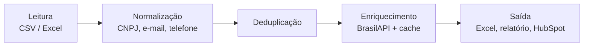

# leads-cnpj

[](https://github.com/caiolucasxz55/CRM-leads-cleaning/actions/workflows/ci.yml)

Times comerciais perdem tempo ligando para leads duplicados e para empresas que não
existem mais. O **leads-cnpj** recebe uma planilha de leads bagunçada e devolve uma base
limpa, sem duplicados e enriquecida com dados públicos do CNPJ, pronta para o CRM.

```text
$ leads run examples/leads_exemplo.csv -o limpo.xlsx

                Resultado
┌────────────────────────────────┬───────┐
│ Status                         │ Leads │
├────────────────────────────────┼───────┤
│ Recebidos                      │    30 │
│ Prontos para o CRM             │    15 │
│ Duplicados                     │     8 │
│ CNPJ inválido ou inexistente   │     3 │
│ Empresa inativa                │     4 │
│ Erro na consulta (reprocessar) │     0 │
└────────────────────────────────┴───────┘
15 ligações evitadas · 18 consultas à API · 0 do cache · 9.48s
```

## Resultado na planilha de exemplo

Execução real contra a BrasilAPI usando [`examples/leads_exemplo.csv`](examples/leads_exemplo.csv)
(30 leads, CNPJs públicos de empresas e contatos fictícios):

| Indicador | Leads | % |
|---|---:|---:|
| Leads recebidos | 30 | 100% |
| Prontos para o CRM | 15 | 50% |
| Duplicados | 8 | 27% |
| CNPJ inválido ou inexistente | 3 | 10% |
| Empresa inativa (baixada) | 4 | 13% |
| **Ligações evitadas** | **15** | **50%** |

- **Tempo:** 9,5 s na primeira execução (18 consultas à API); **0,03 s** na segunda,
  com todas as consultas atendidas pelo cache.
- **Valor:** metade da lista não precisava de ligação. Ela tinha leads repetidos,
  CNPJs com dígito errado e quatro empresas baixadas por incorporação (Sadia, Unibanco,
  Banco Real, Tele Norte Leste). Numa base de 1.000 leads com esse perfil, seriam cerca
  de 500 ligações a menos.

Os arquivos gerados estão em [`examples/leads_exemplo_limpo.xlsx`](examples/leads_exemplo_limpo.xlsx)
e [`examples/relatorio_exemplo.md`](examples/relatorio_exemplo.md).

## Como funciona

O pipeline roda em cinco etapas, e cada lead sai com um status que diz o que aconteceu com ele.



1. **Leitura** ([`reader.py`](src/leads/reader.py)): lê CSV (detecta `,` `;` tab e
   codificação UTF-8/Windows-1252) ou Excel, tudo como texto para não perder zeros à
   esquerda. Reconhece colunas como `E-mail`, `Celular`, `Nome do Contato` e
   `Razão Social`, e preserva as colunas que não conhece.
2. **Normalização** ([`normalize.py`](src/leads/normalize.py)): CNPJ formatado e validado
   pelo dígito verificador, inclusive o **CNPJ alfanumérico** (em vigor desde jul/2026).
   Também recupera CNPJs que o Excel transformou em número (`191` → `00.000.000/0001-91`).
   E-mail vai para minúsculas e é validado; telefone vai para o formato E.164
   (`+5511987654321`), com checagem de DDD.
3. **Deduplicação** ([`dedupe.py`](src/leads/dedupe.py)): agrupa pelo CNPJ e, quando ele
   falta, por e-mail ou telefone. O lead mais completo vira o principal e herda os campos
   vazios dos duplicados.
4. **Enriquecimento** ([`enrich.py`](src/leads/enrich.py)): consulta a
   [BrasilAPI](https://brasilapi.com.br/docs#tag/CNPJ) e preenche razão social, nome
   fantasia, CNAE principal, porte, cidade, UF e situação cadastral.
5. **Saída** ([`export.py`](src/leads/export.py)): gera a planilha limpa, o relatório e,
   se você pedir, cria as empresas no HubSpot.

### Status de cada lead

| Status | Significado |
|---|---|
| `ok` | Pronto para o CRM. Se o lead não tinha CNPJ, o `detalhe` avisa que ele não foi enriquecido. |
| `duplicado` | Mesmo lead de outra linha. A coluna `duplicado_de` aponta a linha principal. |
| `cnpj_invalido` | Dígito verificador errado ou CNPJ inexistente na Receita. |
| `empresa_inativa` | Situação cadastral diferente de ATIVA (baixada, inapta, suspensa, nula). |
| `erro_consulta` | A API falhou mesmo após as novas tentativas. Rode de novo para reprocessar. |

A coluna `detalhe` explica cada caso, por exemplo `situação cadastral BAIXADA (INCORPORACAO)`
ou `e-mail inválido descartado: fabio.nunes@example`.

## Instalação

Requer Python 3.11+.

```bash
python -m venv .venv
source .venv/bin/activate          # Windows: .venv\Scripts\activate
pip install -e .
```

### Com Docker

```bash
# processa a planilha de exemplo e grava em examples/saida/
docker compose run --rm leads

# outra planilha: coloque-a em ./examples e rode
docker compose run --rm leads run minha_planilha.xlsx -o saida/limpo.xlsx -r saida/relatorio.md

# sem compose
docker build -t leads-cnpj .
docker run --rm -v "$PWD/examples:/data" leads-cnpj run leads_exemplo.csv -o saida/limpo.xlsx
```

A imagem roda com um usuário sem privilégios (uid 1000) e trabalha no volume `/data`.
O cache das consultas fica em `/data/.cache/`, então é reaproveitado entre execuções.

## Uso

```bash
leads run entrada.csv --saida limpo.xlsx --relatorio relatorio.md
```

| Opção | Descrição |
|---|---|
| `-o, --saida` | `.xlsx` (abas `prontos_crm`, `todos` e `resumo`) ou `.csv` (separado por `;`). Padrão: `<entrada>_limpo.xlsx` |
| `-r, --relatorio` | Relatório em `.md` ou `.json` |
| `--cache` | Arquivo SQLite do cache (padrão `.cache/cnpj.sqlite`, ou a variável `LEADS_CACHE_PATH`) |
| `--cache-dias` | Validade do cache em dias (padrão 30; `0` = sem validade) |
| `--sem-cache` | Não lê nem grava o cache |
| `--sem-enriquecimento` | Só normaliza e deduplica, sem consultar a API |
| `--intervalo` | Segundos mínimos entre consultas (padrão 0,5; a BrasilAPI limita rajadas) |
| `--hubspot` | Envia os leads `ok` para o HubSpot |
| `-v, --verbose` | Mostra os logs de cada etapa |

```bash
leads cache info      # quantos CNPJs estão no cache
leads cache limpar    # apaga o cache
```

### Envio para o HubSpot

1. Crie uma *Private App* no HubSpot com o escopo `crm.objects.companies.write`.
2. Copie `.env.example` para `.env` e preencha `HUBSPOT_TOKEN` (ou exporte a variável).
3. Rode com `--hubspot`:

```bash
leads run entrada.csv --hubspot --hubspot-cnpj-prop cnpj
```

Os leads `ok` viram **empresas**, enviadas em lotes de 100 pelo endpoint batch da API v3.
Os campos mapeados são nome (razão social), telefone, cidade, UF, CNAE na descrição e o
domínio do e-mail corporativo (domínios gratuitos como gmail.com são ignorados).
O CNPJ só é enviado se você criar uma propriedade personalizada e indicá-la em
`--hubspot-cnpj-prop`. Se algum lote falhar, os outros continuam e o comando termina
com código 2.

## Decisões técnicas

- **Cache das consultas:** um CNPJ já consultado não é consultado de novo. O SQLite guarda
  a resposta bruta da API (não o resultado processado), então mudar o parser não exige
  consultar tudo outra vez. Só respostas definitivas vão para o cache (empresa encontrada
  ou CNPJ inexistente); falhas temporárias não.
- **Retry com espera crescente:** em falha de rede, 429 ou 5xx, espera 2 s, 4 s, 8 s e
  16 s e respeita o cabeçalho `Retry-After`. Isso fica num módulo próprio
  ([`http.py`](src/leads/http.py)), que o cliente do HubSpot também usa.
- **Nenhum lead some:** quem falha em alguma etapa sai com o status do erro, e a saída
  sempre tem o mesmo número de linhas da entrada.
- **Deduplicação segura:** dois leads com CNPJs válidos diferentes nunca são juntados,
  mesmo que compartilhem um e-mail ou telefone (é comum o mesmo escritório de
  contabilidade atender várias empresas). Isso vale também para pontes transitivas
  (A↔B por e-mail, B↔C por telefone).
- **Provider plugável:** `CnpjProvider` é um `Protocol`. Para trocar a BrasilAPI por
  outra fonte (ReceitaWS, CNPJá), basta implementar `fetch` e `parse`.
- **Testes sem rede:** os testes de enriquecimento usam respostas reais da BrasilAPI
  salvas em [`tests/fixtures`](tests/fixtures), sem o quadro de sócios.

## Estrutura

```text
├── src/leads/
│   ├── reader.py      # leitura de CSV/Excel e mapeamento de colunas
│   ├── normalize.py   # CNPJ (+ dígito verificador), e-mail, telefone
│   ├── dedupe.py      # agrupamento de duplicados (union-find)
│   ├── enrich.py      # BrasilAPI, enriquecimento e status
│   ├── cache.py       # cache SQLite das consultas
│   ├── http.py        # retry com espera crescente
│   ├── export.py      # planilha, relatório e HubSpot
│   ├── pipeline.py    # junta as etapas e gera as métricas
│   ├── models.py      # status, colunas e dados da empresa
│   └── cli.py         # leads run / leads cache
├── tests/             # 150+ testes, ~97% de cobertura
├── examples/          # planilha de exemplo e resultado
├── Dockerfile         # build, test e runtime (multi-stage)
└── docker-compose.yml
```

## Desenvolvimento

```bash
pip install -e ".[dev]"

pytest --cov          # testes com cobertura
ruff check .          # lint
ruff format .         # formatação
mypy                  # tipagem estrita

docker compose run --rm tests   # tudo isso dentro do container
```

O CI (GitHub Actions) roda lint, tipagem e testes em Python 3.11, 3.12 e 3.13 e
constrói a imagem Docker.

## Dados e privacidade

A planilha de exemplo usa apenas CNPJs de empresas, que são dados públicos. Os contatos
são fictícios e usam o domínio reservado `example.com`. A BrasilAPI também devolve o
quadro de sócios (QSA), mas o projeto não usa esse dado e ele foi removido das fixtures.

## Evolução

Depois do MVP, o mesmo repositório pode ganhar o follow-up automático de leads parados,
já que os dois trabalham sobre a mesma base:

- um robô agendado verifica no CRM os leads sem contato há mais de N dias;
- cria uma tarefa para o vendedor responsável;
- envia um resumo diário por vendedor com os leads que estão esfriando;
- um LLM escreve o rascunho do e-mail de retomada, mas quem envia é o vendedor.
